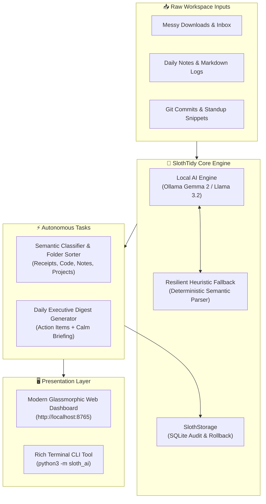

# 🦥 SlothTidy AI

> **Ambient Local-First Workspace Organizer & Overnight Digest Engine**  
> *Built for the **Hacktoberfest Open-Source AI Challenge: Week 3 ("Slow and Steady")***

[](LICENSE)
[](https://www.python.org/)
[](https://dev.to)
[](https://ollama.com)
[](#privacy-guarantee)

---

## 🌿 The Inspiration: Slow and Steady

In today's hyperactive developer workflow, our digital workspaces become chaotic: cluttered download folders, unorganized snippets, fragmented notes, and exhausting notification backlogs.

Inspired by **International Sloth Day** and the Hacktoberfest Week 3 theme **"Slow and Steady"**, **SlothTidy AI** channels the mindful pace of the sloth. Rather than rushing you with intrusive alerts, it operates quietly in the background:

1. **Ambient File Tidier**: Classifies messy desktop items and downloads into semantic categories with zero manual effort.
2. **Overnight Morning Briefing**: Summarizes your raw notes, terminal logs, and git commits into a serene executive morning brief with clear action items and calming sloth wisdom.
3. **100% Local Privacy**: Runs entirely on your machine via open-weight models (Ollama: Gemma 2, Llama 3.2, Qwen 2.5) with a resilient deterministic local rule fallback. **Zero tokens or telemetry ever leave your machine.**

---

## 🏗️ Architecture



---

## ✨ Features

- 🔒 **Zero-Cloud, Absolute Privacy**: Everything runs locally. Sensitive invoices, confidential project roadmaps, and personal diaries are never transmitted over the internet.
- ⚡ **Dual-Core AI Architecture**: Seamlessly connects to **Ollama** (`gemma2:2b`, `llama3.2`, `mistral`) for deep neural understanding, while gracefully degrading to high-performance local deterministic heuristics if Ollama is offline.
- 🗂️ **Autonomous Workspace Sorter**: Ingests files, analyzes content snippets, categorizes them into designated directories, and keeps a transaction log in SQLite.
- 🌅 **Overnight Morning Digest**: Condenses fragmented logs and todo notes into an executive summary with extracted actionable checkboxes.
- 🌐 **Zero-Dependency Modern Web UI**: Built-in Python web server serving a responsive dark-mode dashboard without requiring external Node.js builds or heavy frameworks.
- 🧪 **Fully Tested**: Comprehensive unit test suite with 100% verified passing tests.

---

## 🚀 Quickstart

### 1. Clone & Run (Zero Dependencies Needed!)

SlothTidy AI is engineered using Python's standard library for universal compatibility:

```bash
git clone https://github.com/your-username/sloth-tidy-ai.git
cd sloth-tidy-ai
```

### 2. View System Health

```bash
python3 -m sloth_ai.cli status
```

### 3. Tidy Unorganized Files

Perform a dry run to see what SlothTidy will organize:
```bash
python3 -m sloth_ai.cli tidy --folder examples/inbox --dry-run
```

Organize files into their semantic homes:
```bash
python3 -m sloth_ai.cli tidy --folder examples/inbox
```

### 4. Generate an Overnight Morning Digest

```bash
python3 -m sloth_ai.cli digest --file examples/notes/oct_25_thoughts.md
```

### 5. Launch the Web Dashboard

```bash
python3 -m sloth_ai.cli serve --port 8765
```
Open **[http://localhost:8765](http://localhost:8765)** in your browser!

---

## 🧠 Optional: Power Up with Open-Weight Models (Ollama)

To use deep open-weight models for richer reasoning:

1. Install [Ollama](https://ollama.com).
2. Pull your model of choice:
   ```bash
   ollama pull gemma2:2b
   ```
3. Run SlothTidy AI. It will automatically detect Ollama and route inference to Gemma!

---

## 🧪 Running Automated Tests

Run the test suite with Python's built-in test runner:

```bash
python3 -m unittest discover tests
```

---

## 💡 Why Does Open Innovation Matter?

1. **User Sovereignty & Data Privacy**: Desktop organization and daily note synthesis require reading personal files. Proprietary cloud APIs demand trusting third-party servers with sensitive data. Open-source AI guarantees complete data ownership.
2. **Offline Accessibility**: A true ambient background assistant should work reliably on an airplane, during internet outages, or on off-grid laptops without recurring monthly token fees.
3. **Customizability**: Open weights enable developers to inspect model reasoning, fine-tune prompts, adjust categorization thresholds, and build community extensions without vendor lock-in.

---

## 📜 License

Distributed under the **MIT License**. See [LICENSE](LICENSE) for details.
