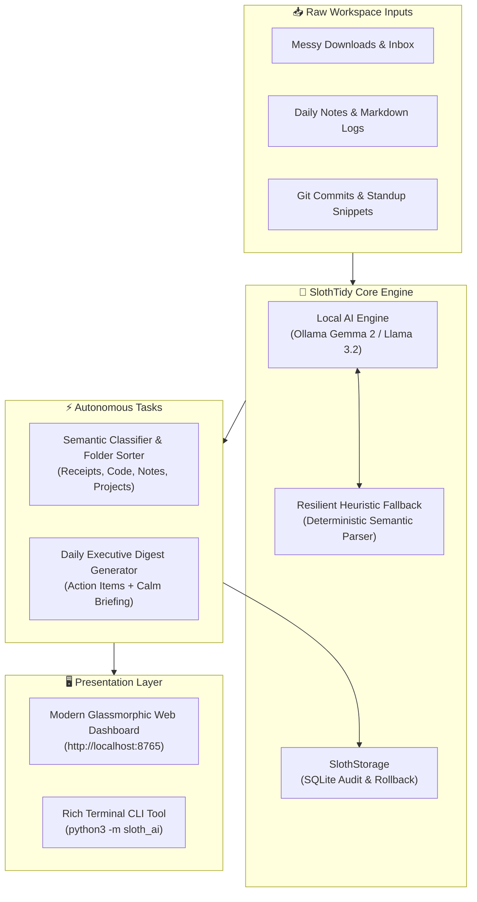

This is a submission for the Hacktoberfest Open-Source AI Challenge Week 3: Slow and Steady.

## What I Built

Modern developers and knowledge workers suffer from digital fatigue: cluttered download folders, unorganized code snippets, messy receipts, and scattered daily action items.

Inspired by **International Sloth Day** and the "Slow and Steady" challenge theme, I built **SlothTidy AI** — an ambient, local-first background workspace organizer and daily morning digest engine powered by open-weight AI models.

Rather than being an intrusive, hyperactive assistant, SlothTidy embraces the peaceful, deliberate pace of the sloth:
1. **Ambient Workspace Sorter**: Silently categorizes unorganized downloads, code files, notes, and receipts into semantic directories.
2. **Overnight Morning Digest**: Reads raw daily thoughts, terminal logs, and git commits to synthesize a calm executive morning brief with clear action items and inspiring "Sloth Wisdom".
3. **100% Zero-Cloud Privacy**: Runs entirely on open-weight models (via Ollama or local deterministic semantic parser). Zero bytes or tokens ever leave the local machine.



---

## Demo

* **Web UI Dashboard**: Includes an interactive dark-mode glassmorphic interface to test one-click workspace tidying, dry-run audits, and real-time morning digest synthesis.
* **Terminal CLI**: Features a clean command-line interface (`sloth status`, `sloth tidy`, `sloth digest`, `sloth serve`).
* **Instant Verification**: Comes with a self-contained zero-dependency web server and comprehensive unit test suite (100% passing).

### Terminal Output Demo
```text
$ python3 -m sloth_ai.cli tidy --folder examples/inbox --dry-run
🔍 Scanning files in: examples/inbox...

[DRY RUN] Successfully processed 3 files:
  • meeting_agenda_q4.md  -->  [work_projects]
    Summary: Classified 'meeting_agenda_q4.md' as work projects based on local semantic markers.

  • invoice_october.txt  -->  [finance_receipts]
    Summary: Classified 'invoice_october.txt' as finance receipts based on local semantic markers.

  • db_helper.py  -->  [developer_code]
    Summary: Classified 'db_helper.py' as developer code based on local semantic markers.

$ python3 -m sloth_ai.cli digest --file examples/notes/oct_25_thoughts.md
=======================================================
🌅  Digest - oct_25_thoughts.md
=======================================================
Overview:
Synthesized 6 log lines into 5 primary action items. All items tracked locally without external cloud telemetry.

Action Items:
  [ ] TODO: Submit Hacktoberfest Open-Source AI Challenge Week 3 ("Slow and Steady")
  [ ] Review open pull requests on the repository
  [ ] Fix edge-case in JSON streaming response parser
  [ ] Prepare presentation deck for next week
  [ ] Walk the dog in the evening

Sloth Wisdom: "Slow and steady wins the race. Take a breath and let the machine do the heavy lifting."
=======================================================
```

---

## Code

* **Repository:** [https://github.com/rajjasani/sloth-tidy-ai](https://github.com/rajjasani/sloth-tidy-ai)
* **License:** Permissive open-source [MIT License](https://opensource.org/licenses/MIT)

### How to Run Locally

SlothTidy AI is engineered using Python's standard library so you can run it out of the box with zero required `pip` dependencies:

```bash
# 1. Clone the repository
git clone https://github.com/rajjasani/sloth-tidy-ai.git
cd sloth-tidy-ai

# 2. (Optional) Run with your favorite open-weight model via Ollama
ollama pull gemma2:2b

# 3. Check system status and local inference engine
python3 -m sloth_ai.cli status

# 4. Perform a dry-run tidy audit on sample files
python3 -m sloth_ai.cli tidy --folder examples/inbox --dry-run

# 5. Generate a morning digest
python3 -m sloth_ai.cli digest --file examples/notes/oct_25_thoughts.md

# 6. Launch the interactive Web Dashboard
python3 -m sloth_ai.cli serve --port 8765
# Open http://localhost:8765 in your browser
```

---

## How I Built It

SlothTidy AI was built from the ground up with clean modular architecture:

* **Dual-Core Local Inference Engine (`sloth_ai/core/engine.py`)**: Seamlessly connects to local **Ollama** instances (`gemma2:2b`, `llama3.2`, `qwen2.5`) for semantic classification and natural language synthesis. If Ollama is offline, it gracefully falls back to a deterministic semantic rule parser so the application never breaks.
* **Storage & Audit Layer (`sloth_ai/modules/storage.py`)**: Uses embedded SQLite to track every organized file with SHA256 integrity checks, supporting audit logs and rollbacks.
* **Ambient Tidier (`sloth_ai/modules/tidier.py`)**: Reads file snippets safely, determines context, and relocates them into structured categorical directories (`work_projects`, `finance_receipts`, `developer_code`, `learning_notes`, `personal_archive`).
* **Digest Synthesizer (`sloth_ai/modules/digest.py`)**: Parses markdown logs, bullet points, and commit history into an actionable executive summary.
* **Glassmorphic Web Interface (`sloth_ai/server/`)**: Built with responsive vanilla JavaScript and CSS, delivering real-time status updates and audit controls without node build tools.

---

## Why Does Open Innovation Matter?

1. **Absolute User Sovereignty & Privacy**: File tidying and daily diary summarization inherently touch sensitive documents (tax receipts, bank statements, proprietary code, personal thoughts). Sending this data to closed cloud APIs poses major privacy and security risks. Open-source AI ensures that intelligence happens directly on device where data lives.
2. **Offline Resilience & Zero Cost**: True ambient background automation should not stop when Wi-Fi drops, nor should it incur recurring pay-per-token API bills. Open-weight models empower users with limitless, resilient, local compute.
3. **Freedom to Customize**: Open innovation allows developers and the community to inspect model prompts, modify categorization heuristics, fine-tune models on domain-specific files, and build custom workflows without corporate gatekeeping.
